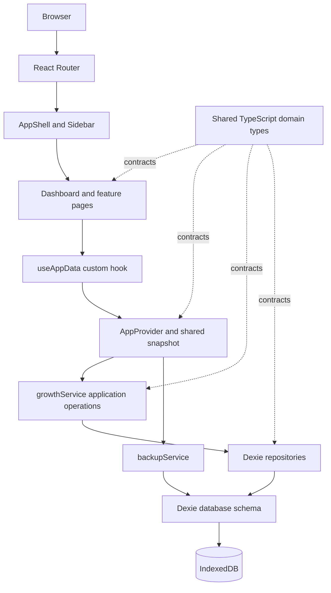
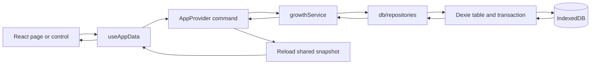

# My Growth Dashboard

A private, local-first personal growth workspace for daily practice, habits, 30-day challenges, reflection, and progress review. The app runs in the browser, persists data in IndexedDB, and has no backend or account requirement.

## Contents

1. [Project Overview](#1-project-overview)
2. [Features](#2-features)
3. [Technology Stack](#3-technology-stack)
4. [Project Structure](#4-project-structure)
5. [Application Architecture](#5-application-architecture)
6. [Data Flow](#6-data-flow)
7. [Database Documentation](#7-database-documentation)
8. [React Concepts Used](#8-react-concepts-used)
9. [Installation and Setup](#9-installation-and-setup)
10. [Development Commands](#10-development-commands)
11. [Application Workflows](#11-application-workflows)
12. [Data Persistence and Backup](#12-data-persistence-and-backup)
13. [Design System](#13-design-system)
14. [Future Improvements](#14-future-improvements)
15. [Development Guidelines](#15-development-guidelines)
16. [Current Project Status](#16-current-project-status)

## 1. Project Overview

My Growth Dashboard helps one person turn long-term goals into repeatable daily actions. It brings activity planning, a daily checklist, focused 30-day challenges, journal prompts, and progress trends into one responsive application.

The application is local-first by design:

- Data is stored in the browser's IndexedDB database named `my-growth-dashboard`.
- There is no API server, login, cloud sync, or third-party analytics.
- Progress is derived from saved activities and records. The app does not seed demo activities or fabricated completion history.
- Five built-in categories are created on first launch. Users can add their own categories.
- A JSON backup is the supported way to move all data to another browser or device.

## 2. Features

### Dashboard

- Shows today's completion percentage, completed and pending activity counts, active challenge count, and current streak.
- Lists up to six active activities with a completion control. The full list is available in the Daily Tracker.
- Displays a rolling 30-day activity calendar based only on saved daily records.
- Shows recent journal reflections and links to the journal, tracker, and challenges.
- Empty states guide a new user to create the first activity instead of showing sample progress.

### Activity Management

- Create, edit, pause, reactivate, search, filter, and delete activities.
- Assign one of the five built-in categories or a user-created category.
- Set a daily target and unit, estimated minutes, and an optional description.
- Pausing an activity removes it from today's active checklist but keeps its existing records.
- Deleting an activity requires confirmation and deletes that activity's daily records as well.

### Daily Tracker

- Move between today and previous dates. Future dates cannot be selected for logging.
- Mark an activity complete or pending with a checkbox.
- Add time spent, personal notes, and one or more HTTP/HTTPS reference links.
- See completion status, target, estimated time, and calculated daily progress.
- A record is created the first time an activity is checked or its details are saved. Later edits update the same date/activity record.
- Past dates remain editable for review and correction.

### 30-Day Challenges

- Start a named challenge in any category with a selected start date. Its end date is calculated as day 30.
- Review a 30-day calendar and select an individual day to see its completion percentage and reflection note.
- Mark today's or a past day's challenge completion. Future days cannot be completed early.
- Pause, resume, archive, or delete a challenge. Paused challenges still allow review of earlier days.
- The service prevents duplicate records for the same challenge and date.
- A challenge is marked complete after all 30 distinct days are checked. Removing a completion from a finished challenge returns it to active status.
- Each challenge shows total days complete, overall percent, and its current consecutive-day streak.
- Completed and archived challenges remain in the history section and analytics.

### Daily Journal

- Write and edit dated reflections using five prompts:
  - What did I complete today?
  - What did I learn today?
  - What mistakes did I make?
  - What should I improve tomorrow?
  - Tomorrow's priorities.
- At least one field must contain text before an entry can be saved.
- Browse and reopen saved entries from the journal history. One entry per date is stored; saving again edits that entry.

### Progress Analytics

- Shows daily, current-week, and rolling 30-day completion rates plus the current streak.
- Uses Recharts for a 30-day consistency area chart, current-week performance bars, a 30-day performance chart, and today's completed/pending split.
- Shows completion performance for categories with activities and a history of completed/archived challenges.
- The weekly start day can be set to Monday or Sunday.
- Daily rate denominators include activity definitions created by the date being measured. Since activity deactivation dates are not stored, historical rates do not reconstruct exactly when a paused activity stopped being active.
- All calculations use the user's saved records; blank days are not filled with generated data.

### Settings

- Switch between dark and light themes. Dark is the default.
- Choose whether completed items are hidden from the Daily Tracker.
- Choose the first day shown in the weekly analytics view.
- Export all application tables to a versioned JSON backup.
- Restore a validated JSON backup after an explicit confirmation. Restore replaces the current local dataset.
- Export daily activity records to CSV. Challenge and journal data are included in JSON, not in the CSV export.
- Shows application version, storage type, local-only sync status, and saved record counts.

### Shared interaction details

- Responsive desktop sidebar and horizontally scrollable mobile navigation.
- Reusable buttons, dialogs, progress bars, page headers, empty states, and error banners.
- Activity and challenge forms use React Hook Form with Zod validation.
- Database errors are surfaced in a dismissible page-level error banner.
- Reduced-motion preferences are respected in CSS.

## 3. Technology Stack

| Technology | Purpose in this project |
| --- | --- |
| React 19 | Composes the application shell, shared controls, and feature screens. |
| TypeScript 5 | Defines domain records, page props, database tables, and service contracts. Strict mode is enabled. |
| Vite 7 | Runs the development server and creates the production bundle. |
| Tailwind CSS 4 | Provides the installed utility CSS pipeline through `@tailwindcss/vite`; the app uses a small token-based stylesheet for its shared design system. |
| React Router DOM 7 | Provides client-side navigation between the dashboard and feature screens. |
| Lucide React | Supplies consistent interface icons. |
| Recharts 3 | Renders the analytics charts. |
| React Hook Form | Manages activity and challenge forms with minimal form state wiring. |
| Zod 4 and `@hookform/resolvers` | Validate form input and imported JSON backup data. |
| Dexie 4 | Defines IndexedDB tables, indexes, transactions, upserts, and database versioning. |
| Context API and React Hooks | Share the loaded workspace snapshot and mutations without prop drilling. |
| `clsx` and `tailwind-merge` | Compose reusable button classes without conflicting Tailwind utilities. |
| `fake-indexeddb`, `tsx`, and Node's test runner | Run the data-layer tests against an isolated in-memory IndexedDB implementation. These are development-only dependencies. |

No backend, authentication, cloud database, analytics service, or external font service is used.

## 4. Project Structure

```text
.
|-- README.md
|-- index.html
|-- package.json
|-- package-lock.json
|-- tsconfig.json
|-- vite.config.ts
|-- tests/
|   `-- data-layer.test.ts
`-- src/
    |-- App.tsx
    |-- main.tsx
    |-- index.css
    |-- components/
    |   |-- layout/
    |   |   |-- AppShell.tsx
    |   |   `-- Sidebar.tsx
    |   `-- ui/
    |       |-- Button.tsx
    |       |-- ConfirmDialog.tsx
    |       |-- Feedback.tsx
    |       |-- Modal.tsx
    |       |-- PageHeader.tsx
    |       `-- ProgressBar.tsx
    |-- context/
    |   `-- AppContext.tsx
    |-- db/
    |   |-- database.ts
    |   `-- repositories.ts
    |-- pages/
    |   |-- Activities/
    |   |   |-- ActivitiesPage.tsx
    |   |   `-- ActivityDialog.tsx
    |   |-- Analytics/
    |   |   `-- AnalyticsPage.tsx
    |   |-- Challenges/
    |   |   |-- ChallengeDialog.tsx
    |   |   `-- ChallengesPage.tsx
    |   |-- DailyTracker/
    |   |   `-- DailyTrackerPage.tsx
    |   |-- Dashboard/
    |   |   `-- DashboardPage.tsx
    |   |-- Journal/
    |   |   `-- JournalPage.tsx
    |   `-- Settings/
    |       `-- SettingsPage.tsx
    |-- services/
    |   |-- backupService.ts
    |   `-- growthService.ts
    |-- types/
    |   `-- index.ts
    `-- utils/
        |-- cn.ts
        |-- dates.ts
        `-- progress.ts
```

### Important files

- `src/App.tsx` - wraps the router and application provider, then declares all application routes.
- `src/main.tsx` - React DOM entry point, React Strict Mode, and global stylesheet import.
- `src/index.css` - theme tokens, shared component styles, responsive breakpoints, and reduced-motion rules.
- `src/context/AppContext.tsx` - loads the snapshot, exposes mutations, applies the stored theme, and reports persistence errors.
- `src/db/database.ts` - Dexie database name, version 1 schema, table definitions, default categories, and first-run settings.
- `src/db/repositories.ts` - IndexedDB reads, transactional writes, unique-record upserts, and activity/challenge cleanup.
- `src/services/growthService.ts` - application operations such as creating activities, assigning timestamps, category validation, and deriving challenge end dates.
- `src/services/backupService.ts` - backup schema validation, restore transactions, JSON/CSV serialization, and file downloads.
- `src/types/index.ts` - domain models and input types shared between pages and data access.
- `src/utils/dates.ts` - local date keys, date ranges, and challenge date calculations.
- `src/utils/progress.ts` - daily counts, completion rates, challenge progress, and streak calculations.
- `tests/data-layer.test.ts` - persistence, uniqueness, calculation, restore, and reopen smoke tests.
- `vite.config.ts` - React, Tailwind v4, `@` path alias, and single-file production output plugins.

There is no `assets/` directory because the interface does not require image assets.

## 5. Application Architecture

The application is organized into feature pages and shared infrastructure. Pages render user-facing workflows. The `useAppData()` custom hook reads the provider's shared snapshot and mutation methods. `growthService.ts` applies application-level rules, while `db/repositories.ts` owns IndexedDB operations. `backupService.ts` handles import/export concerns separately.



The service and repository boundaries are intentional: a future remote adapter can replace or sit beside the Dexie repository without changing how feature pages read shared state. No remote implementation exists today.

## 6. Data Flow

For a daily completion, the page asks the context to save a record. The service passes the operation to the Dexie repository. The repository performs an IndexedDB transaction, looks up the compound date/activity key, and updates the existing row or inserts one new row. The provider reloads the workspace snapshot after a successful mutation so dashboard counts, tracker rows, and charts recalculate from persisted data.



Backup actions use `backupService.ts` to validate and serialize the snapshot. Restore validates the complete file and record relationships before replacing stores in one read/write transaction.

## 7. Database Documentation

### Database identity and version

- **Database name:** `my-growth-dashboard`
- **Current schema version:** `1`
- **Database engine:** browser IndexedDB, accessed through Dexie 4
- **Schema definition:** `src/db/database.ts`
- **Initialization:** `initializeDatabase()` opens the database and seeds the five default categories and dark theme settings only when their stores are empty.

### Tables

`++id` means an auto-incrementing numeric primary key. `&` marks a unique index. Dates used as day keys use the local `YYYY-MM-DD` format. Timestamps use ISO strings.

| Table | Fields | Indexes and purpose |
| --- | --- | --- |
| `activities` | `id: number`, `name: string`, `description: string`, `categoryId: number`, `dailyTarget: number`, `targetUnit: TargetUnit`, `estimatedMinutes: number`, `isActive: boolean`, `createdAt: string`, `updatedAt: string` | `++id`, `name`, `categoryId`, `isActive`, `createdAt`. Stores reusable activity definitions. |
| `dailyRecords` | `id: number`, `date: string`, `activityId: number`, `completed: boolean`, `timeSpentMinutes: number`, `notes: string`, `referenceLinks: string[]`, `updatedAt: string` | `++id`, unique compound `&[date+activityId]`, `date`, `activityId`, `completed`. Stores one activity check-in per day. |
| `challenges` | `id: number`, `name: string`, `description: string`, `categoryId: number`, `startDate: string`, `endDate: string`, `status: ChallengeStatus`, `createdAt: string`, `updatedAt: string` | `++id`, `name`, `status`, `startDate`, `categoryId`. Stores the 30-day challenge definition and lifecycle state. |
| `challengeRecords` | `id: number`, `challengeId: number`, `date: string`, `completed: boolean`, `note: string`, `updatedAt: string` | `++id`, unique compound `&[challengeId+date]`, `challengeId`, `date`, `completed`. Stores challenge days separately from daily activity records. |
| `journalEntries` | `id: number`, `date: string`, `completedToday: string`, `learnedToday: string`, `mistakesToday: string`, `improveTomorrow: string`, `prioritiesTomorrow: string`, `createdAt: string`, `updatedAt: string` | `++id`, unique `&date`, `createdAt`. Stores at most one journal entry per date. |
| `categories` | `id: number`, `name: string`, `color: string`, `isCustom: boolean`, `createdAt: string` | `++id`, unique `&name`, `isCustom`. Holds the five standard and user-created categories. |
| `settings` | `key: "app"`, `theme: "dark" \| "light"`, `weekStartsOn: "monday" \| "sunday"`, `hideCompletedActivities: boolean` | Unique primary key `&key`. Stores the single application preference record. |

`TargetUnit` is `sessions | minutes | pages | repetitions | custom`. `ChallengeStatus` is `active | paused | completed | archived`.

### Relationships and constraints

- `activities.categoryId` points to `categories.id`.
- `challenges.categoryId` points to `categories.id`.
- `dailyRecords.activityId` points to `activities.id`.
- `challengeRecords.challengeId` points to `challenges.id`.
- IndexedDB does not enforce foreign keys. Repositories validate category/activity/challenge existence during writes. Backup import also validates the relationships before restore.
- Unique compound indexes and repository upserts prevent duplicate daily activity or challenge records. The journal's unique `date` index prevents duplicate entries for a day.
- Deleting an activity removes its daily records in the same transaction. Deleting a challenge removes its challenge-day records in the same transaction.

### Versioning and persistence

`GrowthDatabase` currently declares `version(1).stores(...)`. When the schema changes, add `version(2)` and a Dexie upgrade function rather than editing existing user data in place. Persisted data remains in the browser across reloads for the same origin. Browser storage can still be cleared by the user, browser policy, or private browsing, so regular JSON exports are recommended.

## 8. React Concepts Used

| Concept | Where it is used |
| --- | --- |
| Components and composition | Shared controls live in `src/components/ui/`; the application shell composes the sidebar, error banner, routed page, and footer. |
| Props | Buttons, dialogs, empty states, progress bars, activity rows, and challenge rows receive typed values and callbacks from their parents. |
| State | `useState` holds transient UI choices such as the selected date, open dialog, search query, expanded record editor, and form text. Persisted domain data is not kept as a separate source of truth in each page. |
| `useState` | Used in pages, dialogs, and `AppProvider` for loading, error, and local interaction state. |
| `useEffect` | Initializes IndexedDB on provider mount, applies the saved theme, resets date-bound forms when their entry changes, and synchronizes an expanded record editor after a saved record changes. |
| `useContext` | `useAppData()` reads `AppContext` without passing database data through every layout component. |
| Custom hooks | `useAppData()` combines `useContext` with a guard that ensures it is called under `AppProvider`. |
| `useMemo` | Derives filtered activity lists, daily chart series, and category performance from saved snapshots. |
| `useCallback` | Stabilizes provider reload, mutation, and context actions. |
| React Router | `BrowserRouter`, `Routes`, `Route`, `NavLink`, `Link`, and `Navigate` provide page navigation and route fallback behavior. |
| Forms | React Hook Form registers activity and challenge fields; Zod validates them. Journal prompts use registered fields and a Zod refinement. Search, date, notes, preferences, and daily-record details are controlled with React state. |
| Strict Mode | `src/main.tsx` renders the application inside React `StrictMode` to help expose unsafe side effects during development. |

## 9. Installation and Setup

### Prerequisites

- Node.js 20.19+ or 22.12+
- npm
- A modern browser with IndexedDB enabled

### Install and run

```bash
git clone <repository-url>
cd <repository-directory>
npm install
npm run dev
```

Open the local URL printed by Vite, usually `http://localhost:5173`.

The app has no environment variables and no backend setup. IndexedDB is scoped to the origin used to open the application, so switching between `localhost`, a deployed domain, or different ports creates separate local datasets.

## 10. Development Commands

| Command | Purpose |
| --- | --- |
| `npm install` | Install application and development dependencies. |
| `npm run dev` | Start the Vite development server. |
| `npm run build` | Type-transform and create the production bundle in `dist/`. The configured single-file plugin inlines the built JavaScript and CSS into `dist/index.html`. |
| `npm run preview` | Serve the latest production build locally. Run `npm run build` first. |
| `npx tsc --noEmit` | Run the strict TypeScript check without emitting files. |
| `node --import tsx --test tests/data-layer.test.ts` | Run the data-layer tests with Node's built-in test runner and fake IndexedDB. |

There is no `lint` or `test` npm script configured in `package.json`. The test command above is run directly with Node. ESLint is not installed/configured.

## 11. Application Workflows

### Create an activity

1. Open **Activities** and choose **New activity**.
2. Enter a name, category, daily target and unit. A description and estimated time can also be set.
3. Submit the form. The activity is stored as active and becomes available in the Daily Tracker and dashboard.
4. To organize a different area, add a custom category in the Categories section before creating the activity.

### Complete a daily activity

1. Open **Daily tracker** or use the dashboard checklist.
2. Choose today or an earlier date.
3. Check an activity to complete it. Check it again to mark it pending.
4. Use **Add details** to save time spent, a note, or reference URLs. Details can be saved without marking the activity complete.

### Start and manage a challenge

1. Open **Challenges**, choose **New challenge**, then enter a name, category, intention, and start date.
2. Select a calendar day to review it. Mark eligible current or previous days complete and save a short note if useful.
3. Pause or resume the challenge from its header. Archive it to move it to history, or delete it to remove its check-ins.
4. Completing all 30 unique days moves it into completed history automatically.

### Write a journal entry

1. Open **Daily journal** and choose today or a previous date.
2. Fill any one or more prompts. At least one answer is required.
3. Choose **Save entry**. Select a previous entry from the history list to review or edit it.

### Review progress

1. Use the dashboard to check today's progress and recent rhythm.
2. Open **Analytics** for daily, weekly, monthly, category, and challenge-history views.
3. Change the start of the week in **Settings** if the current-week chart should begin on a different day.

### Export and restore data

1. Open **Settings** and choose **Export JSON** for a complete backup.
2. Use **Export CSV** for a spreadsheet-friendly activity-record export.
3. To restore, choose a JSON backup and confirm the replacement. Invalid files and incompatible schema versions are rejected before local stores are changed.

## 12. Data Persistence and Backup

Dexie stores each entity in a separate IndexedDB object store. IndexedDB is asynchronous browser storage and does not require a network connection. Provider mutations write through the repository layer, then reload the shared snapshot from the database so the interface reflects persisted values.

The JSON backup contains:

- `schemaVersion` and `exportedAt` metadata.
- Activities and daily activity records.
- Challenges and challenge-day records.
- Journal entries, categories, and application settings.

Import validates the schema with Zod, checks date/timestamp and field types, verifies record references, and then replaces all tables inside one Dexie read/write transaction. If a store write fails, the transaction rolls back. First-run categories and settings are initialized after restore if the backup omitted them.

CSV export includes daily activity records with date, activity/category names, completion, time spent, notes, and reference links. It is not a full backup. Keep the JSON file somewhere safe if data must survive clearing browser storage or moving to a different browser profile.

## 13. Design System

### Colors

The CSS custom properties in `src/index.css` define both themes.

| Token | Dark theme | Light theme | Use |
| --- | --- | --- | --- |
| `--canvas` | `#0b0e0d` | `#f5f6f2` | Main page background. |
| `--sidebar` | `#090b0a` | `#fbfcf9` | Navigation surface. |
| `--surface` | `#101413` | `#ffffff` | Interactive panels. |
| `--surface-raised` | `#151a18` | `#f0f2ec` | Hover, input, and secondary surface. |
| `--border` | `#232a26` | `#e3e7de` | Fine dividers. |
| `--text` | `#eff2eb` | `#202620` | Primary text. |
| `--muted` | `#8b948d` | `#667064` | Supporting text. |
| `--accent` | `#c0ed86` | `#719f3e` | Progress and completion. |
| `--danger` | `#ec8e82` | `#bd5148` | Destructive/error states. |

### Typography, spacing, and components

- Uses an Inter-first system font stack; no remote font is downloaded.
- Headings use restrained weights and negative letter spacing. Supporting text is smaller and muted.
- Layout spacing is built around compact 4/8px increments, with 1px dividers and restrained radii.
- Shared components are intentionally flat. Borders/backgrounds are reserved for controls, dialogs, charts, and the interactive challenge calendar.
- Completed items and progress use green. Category colors are stored on category records and displayed as small markers.
- Motion is limited to subtle page entry, completion feedback, dialog entry, hover feedback, and progress transitions. Reduced-motion preferences disable those transitions.

### Responsive layout

The desktop layout uses a fixed sidebar. At 940px and below, it becomes a compact top brand bar and horizontally scrollable navigation. The dashboard, tracker, journal, analytics, and settings layouts collapse at narrower breakpoints.

Current CSS breakpoints in `src/index.css` are `1180px`, `940px`, `720px`, and `500px`. These are CSS media-query breakpoints, not Tailwind configuration breakpoints.

## 14. Future Improvements

The following are planned ideas, not implemented features:

- Supabase or another cloud data adapter behind the existing service/repository boundary.
- Authentication and opt-in synchronization across devices.
- PWA installation and service-worker caching.
- More advanced analytics, date-range selection, and downloadable chart reports.
- Automated browser-level tests for navigation, validation, import/export interactions, and responsive states.
- A user-facing migration history for future IndexedDB schema versions.
- Optional activity scheduling rules, if recurring activity patterns are needed beyond active/inactive status.

## 15. Development Guidelines

- Keep page-specific UI in its feature folder under `src/pages/`.
- Put reusable visual controls in `src/components/ui/` and navigation/layout in `src/components/layout/`.
- Define domain types in `src/types/index.ts`. Avoid `any`; prefer narrow input types such as `NewActivity` and `NewChallenge`.
- Keep React pages dependent on `useAppData()` rather than importing Dexie directly.
- Put application rules and orchestration in `src/services/`. Keep IndexedDB transactions, index queries, and persistence in `src/db/repositories.ts`.
- Put schema definitions and initialization in `src/db/database.ts`. Add a new Dexie version and migration when changing persisted structures.
- Put reusable date and calculation logic in `src/utils/` rather than duplicating it across pages.
- Validate user-entered forms with Zod and validate imported files before writing any records.
- Preserve compound unique indexes and transaction boundaries when changing daily or challenge upserts.
- Do not add demo completion data to real user progress. If sample data is introduced for screenshots or onboarding, it must be an explicit, separately invoked setup action.
- Keep future remote storage behind services/repositories; do not add network access to page components.
- Run the strict TypeScript check, data-layer tests, security audit, and production build before merging a change.

## 16. Current Project Status

### Implemented

- [x] React/Vite application shell with desktop and mobile navigation.
- [x] Dashboard metrics, today's activity checklist, 30-day calendar, and recent journal entries.
- [x] Activity CRUD, active/inactive state, five defaults, custom category creation, target, time, and description.
- [x] Daily check-ins, time spent, notes, reference links, previous-day editing, and progress calculations.
- [x] 30-day challenge lifecycle, unique date records, calendar, notes, streak, status changes, and history.
- [x] Five-prompt daily journal with date-based create/edit/history.
- [x] Daily/weekly/monthly/category/challenge analytics.
- [x] Theme and activity preferences, JSON backup/restore, CSV export, and application information.
- [x] Dexie schema version 1, IndexedDB persistence, transactional upserts, and backup validation.
- [x] Five automated data-layer smoke tests for initialization, unique records, calculations, challenge completion, backup restore, and reopening the database.
- [x] Production dependency audit with zero reported vulnerabilities at implementation time.

### Pending verification

- [ ] Browser-level manual QA of navigation, dialogs, form validation, theme switching, file downloads, and responsive breakpoints. No browser executable was available in the implementation environment.
- [ ] Automated DOM/E2E tests. Current automated tests cover the data layer, not rendered React interactions.
- [ ] Linting. No ESLint configuration or lint script is present.

### Planned, not implemented

- [ ] Cloud database, login, or cross-device sync.
- [ ] PWA/service worker.
- [ ] Browser-level automated test suite.
- [ ] Advanced analytics and optional scheduling rules.